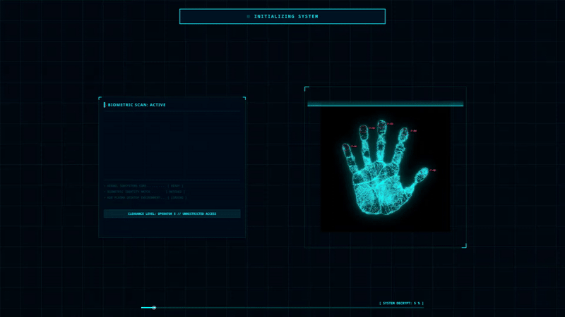
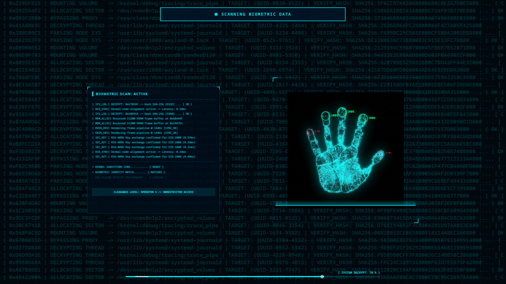

# 🧬 Biometric Identity Scan — Cyberpunk Splash Screen for KDE Plasma 6

A highly detailed, realistic Cyberpunk / Sci-Fi biometric handprint scanner splash screen designed specifically for **KDE Plasma 6** (Qt 6).



---

## ✨ Features

- **100% KDE Plasma 6 & Qt 6 Compliant:** Built without missing module dependencies or legacy syntax errors.
- **Cyberpunk HUD Palette:** Pure Cyan (`#00f0ff`), Alert Green (`#00ff88`), and Crimson Red (`#ff003c`) over a deep space background (`#01080e`).
- **Dynamic Multi-Resolution Background:** Full-screen scrolling matrix console that automatically scales to match **FHD (1080p), QHD (1440p), and 4K (2160p)** displays without empty gaps.
- **Multi-Monitor Safe:** Center-aligned HUD container stays perfectly balanced across single or multi-monitor setups.
- **Randomized Verification Sequence:** Target reticles on fingers blink rapidly and verify in a completely random order on every boot.
- **Expanded Live Terminal Panel:** A 500px wide log panel scrolling continuous real-time decryption entries, kernel logs, and clearance level statuses.
- **Sweeping Laser & HUD Reticles:** Custom animated laser beam with glow effects scanning across the palm print (`handprint.png`).
- **Realistic Progress Decryption:** Simulated system decrypt readout (`0% - 100%`) with realistic pauses and pulse animations.

---

## 📸 Screenshots

| Splash Screen Preview | Status Banner & Terminal |
| :---: | :---: |
|  | *Live terminal logs & randomized finger targets* |

---

## 🚀 Installation

### Option A: Automatic (System Settings)
1. Open **System Settings** -> **Colors & Themes** -> **Splash Screen**.
2. Click **Get New Splash Screens...**
3. Search for `Biometric Identity Scan` and click **Install**.

---

### Option B: Command Line (Plasma 6 Tool)
Clone this repository and install using `kpackagetool6`:

```bash
git clone https://github.com/YOUR_USERNAME/plasma6-bio-scan-splash.git
cd plasma6-bio-scan-splash
kpackagetool6 -t Plasma/LookAndFeel -i bio-scan-splash
```

---

### Option C: Manual Copy
Copy the bio-scan-splash folder directly into your local Plasma look-and-feel directory:

```bash
mkdir -p ~/.local/share/plasma/look-and-feel/
cp -r bio-scan-splash ~/.local/share/plasma/look-and-feel/
```

---

### 🧪 Testing
To test the splash screen locally inside a window without rebooting:

```bash
ksplashqml ~/.local/share/plasma/look-and-feel/bio-scan-splash
```

### 📁 Repository Structure

```text
plasma6-bio-scan-splash/
├── bio-scan-splash/
│   ├── metadata.json
│   └── contents/
│       ├── splash/
│       │   ├── Splash.qml
│       │   ├── handprint.png
│       │   └── preview.png
│       └── previews/
│           └── splash.png
├── .gitignore
├── LICENSE
└── README.md
```

### 📜 Credits & License

- Source Code (QML): Released under the GNU General Public License v3.0. Created by Max.
- Handprint Graphic Asset (handprint.png): Free for personal use. All credit for the     handprint texture belongs to its original graphic creator.

### 👥 Credits & Authors

- **Main Concept & Testing:** Max (@techberode)
- **Programming & QML Optimization:** Developed by Max with assistance from AI (Anthropic Claude).
- **Graphics:** 
  - `handprint.png`: Original artist (Free for personal use).
  - UI Design: Inspired by Cyberpunk HUD aesthetics.

  
<p align="center">
  <i>Developed for KDE Plasma 6.8+</i>
</p>
